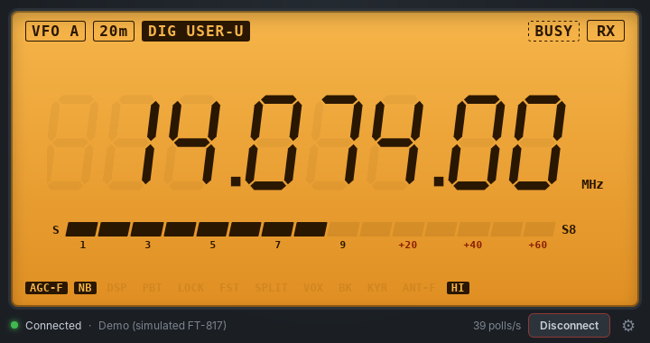
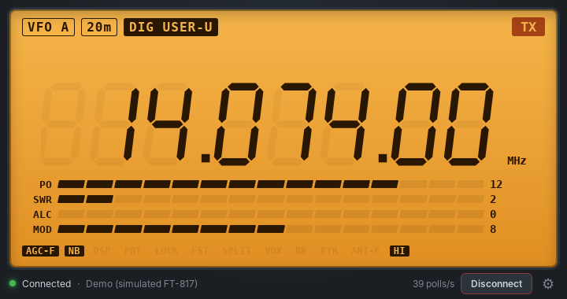

# FT-817 tools: 817 Monitor and 817 EEPROM

Two free desktop apps for the **Yaesu FT-817, FT-817ND and FT-818**, for Windows, macOS and Linux (including Raspberry Pi):

- **[817 Monitor](#817-monitor)**: a large LCD-style display of what the radio is doing. Strictly read-only.
- **[817 EEPROM](#817-eeprom)**: back up the radio's whole EEPROM (calibration, settings, memories) and restore it with verified writes.

They are separate apps on purpose: the monitor contains no code that can write to the radio.

# 817 Monitor

A desktop CAT monitor for the **Yaesu FT-817, FT-817ND and FT-818**. It shows what the radio is doing on a large, LCD-style panel: frequency, mode, S-meter, transmit meters and front-panel settings. The idea comes from hardware CAT displays for the 817, but this is an independent design for Windows, macOS and Linux (including Raspberry Pi).

**Read-only by design.** The app never changes anything on the radio. Every frame it sends passes through an allow-list of five read commands, so it cannot send a write, a mode change or the factory reset.




## What it shows

| Area | Receive | Transmit |
|---|---|---|
| Header | VFO A/B, MEM, HOME, QMB · band · mode (incl. DIG sub-mode, narrow filters) · BUSY · RX | TX |
| Frequency | 10 Hz resolution, radio-style `14.074.00` | same |
| Meter | S-meter S1–S9+60 with peak hold | PO, plus SWR / ALC / MOD (optional, see below) |
| Flags | AGC, NB, DSP, PBT, LOCK, FST, SPLIT, VOX, BK, KYR, antenna front/rear, power level | + HI-SWR alert |
| Alerts | CTCSS/DCS mismatch (TONE?), FM off-frequency | |

The LCD color follows the radio's own color setting (menu "Color": blue or amber), or you can pick amber, blue or a dark night mode.

## Connecting

**Direct serial (full detail).** Connect the radio's ACC jack to the computer with a CAT cable (CT-62 type or similar) or an interface such as the Digirig. In Settings, choose the port and the baud rate that matches the radio's CAT RATE menu setting (4800, 9600 or 38400). The link is fixed at 8 data bits, no parity, 2 stop bits.

- Only one program can use the CAT port at a time. A hardware CAT display on the same ACC jack, WSJT-X or a logger will conflict with it.
- RTS and DTR are set low right after the port opens, because some interfaces key the transmitter on them.
- The app polls about 40 cycles per second (around 100–120 frames per second), similar to established hardware displays.

**Hamlib rigctld (share the radio).** To run the monitor alongside WSJT-X or a logger, let rigctld own the port and point everything at it:

```
rigctld -m 1020 -r COM3 -s 38400      # FT-817 / FT-817ND
rigctld -m 1041 -r /dev/ttyUSB0 -s 38400   # FT-818
```

Then choose "Hamlib rigctld" in Settings (default 127.0.0.1:4532) and set WSJT-X to "Hamlib NET rigctl". This mode shows frequency, mode, VFO, split, S-meter, PTT and approximate TX meters. Panel flags (AGC, NB and so on) aren't available through Hamlib.

**Demo.** A built-in simulated FT-817 that cycles through FT8 on 20 m, CW on 40 m and FM on 2 m. You can also start the app with the `--demo` argument (on Linux: `ft817-monitor --demo`).

## Transmit meters (SWR, ALC, MOD)

Power output always works. SWR, ALC and MOD need the undocumented command `0xBD`, so they are **off by default**. Turn them on in Settings → Transmit meters.

Why it's optional: `0xBE`, one value away, is the factory reset, which erases the radio's calibration. The app cannot send `0xBE` (it is blocked in code and covered by a unit test), but a noisy cable could in theory corrupt a byte in transit. With a decent cable the risk is very low, and hardware displays have used `0xBD` for years.

Published sources disagree on how the `0xBD` reply is packed. If SWR moves with your voice and ALC follows the antenna, switch "Reply layout" in Settings.

# 817 EEPROM


The FT-817's EEPROM holds everything the radio knows about itself, including the **76 soft-calibration values** set at the factory. If those are lost (a factory reset, a bad write, a failing EEPROM), the radio is out of calibration, and redoing the alignment is hard without the original numbers. 817 EEPROM keeps a verified copy and can put it back.

**Back up.** Reads the whole EEPROM (6,438 bytes on the FT-817; the end is detected automatically) twice and reconciles any difference by re-reading, so a cable glitch can't give you a silently bad backup. Each backup is saved automatically in the app's backups folder as a `.817ee` file: JSON with a readable hex dump and a SHA-256 checksum. The calibration values are shown by menu name and can be copied as text, so it's easy to keep a written copy as well.

**Restore.** Open a backup, press *Compare with radio*, review what will change, confirm, restore. Its safeguards:

| Safeguard | Why |
|---|---|
| Addresses 0x00–0x05 are never written | 0–3 are an integrity checksum; changing them can make the radio wipe its EEPROM. 4–5 identify the hardware version. |
| Refuses a backup whose version bytes differ from the radio's | Stops a restore from another model or variant. |
| A fresh backup of the radio is saved before anything is written | Every restore can be undone. |
| Only bytes that differ are written; each is read back, with retries | Usually a few dozen writes instead of thousands; stops if writes stop verifying. |
| The radio's current CAT baud rate (0x64 bits 7–6) is kept | Restoring a different rate would cut the link halfway through. |
| Radio must be in receive with the dial LOCK off | The FT-817 can stop answering CAT while locked. |
| A full read-back at the end | You see exactly which bytes, if any, don't match. |

Restoring **calibration from another radio** onto yours would mis-calibrate it: each radio's values are its own. The app can't tell two FT-817s apart, so restore only your own radio's backups.

**First real-radio test (recommended):** back up, change one harmless setting on the radio (for example beep volume), then restore and check that the setting comes back.

Command line, same engine: `cargo run -p ft817-eeprom --example ee_cli -- backup <port> [baud] out.817ee` and `... restore <port> [baud] file.817ee --yes`.

## Install

Download the installer for your system from the [Releases](../../releases) page:

| System | File |
|---|---|
| Windows 10/11 | `.msi` or `-setup.exe` |
| macOS (Apple Silicon / Intel) | `.dmg` (`aarch64` / `x64`) |
| Linux x64 | `.deb`, `.rpm` or `.AppImage` |
| Raspberry Pi 4/5 (64-bit Raspberry Pi OS) | `arm64` `.deb` |

Each app has its own installer: `817.Monitor_…` and `817.EEPROM_…`.

The builds are not code-signed yet, so you'll see a warning the first time:

- **Windows:** SmartScreen → "More info" → "Run anyway".
- **macOS:** right-click the app → Open → Open. If macOS reports the app as damaged, run `xattr -cr "/Applications/817 Monitor.app"` (or `817 EEPROM.app`).
- **Linux:** add yourself to the serial group to open the port without root: `sudo usermod -aG dialout $USER` (log out and back in).

## Build from source

Requirements: [Rust](https://rustup.rs) (stable), Node.js 18+, and on Linux:
`sudo apt install libwebkit2gtk-4.1-dev libayatana-appindicator3-dev librsvg2-dev libudev-dev`

```
npm install
npm run demo          # 817 Monitor with the simulated radio
npm run dev           # 817 Monitor
npm run build         # installers in target/release/bundle/
npm test              # all unit + end-to-end tests (cargo test --workspace)

cd eeprom && npm install
npm run dev           # 817 EEPROM (choose "Demo" to use the simulated radio)
npm run build
```

### Testing without a radio

```
# Linux/macOS: a virtual serial cable with a simulated FT-817 on one end
socat -d -d pty,raw,echo=0,link=/tmp/radio pty,raw,echo=0,link=/tmp/app
cargo run -p ft817-monitor --example sim_serial -- /tmp/radio            # add --static for EEPROM tests
# then select /tmp/app in either app, or from the command line:
cargo run -p ft817-monitor --example cli_monitor -- serial /tmp/app 38400
cargo run -p ft817-eeprom  --example ee_cli -- backup /tmp/app 38400 test.817ee
```

On Windows, use a virtual COM-port pair such as com0com.

### Releasing

Either push a version tag (`git tag v0.1.0 && git push --tags`), or open the Actions tab → release → "Run workflow" and enter a version such as `v0.1.1`. GitHub Actions builds every platform and creates a draft release with the installers attached.

## Project layout

```
crates/ft817-cat/           shared, read-only: CAT frames and decoders, serial link, simulated FT-817 (with EEPROM)
src-tauri/, ui/             817 Monitor (polling loops, rigctld, display)
eeprom/src-tauri/src/engine.rs      817 EEPROM: backup, restore plan, guarded writes (the only write code)
eeprom/src-tauri/src/backupfile.rs  the .817ee file format
eeprom/ui/                  817 EEPROM window
docs/PROTOCOL.md            what is read and written, how it's decoded, and the open questions
```

## Credits

Protocol knowledge comes from Clint Turner KA7OEI's FT-817 CAT and memory-map pages and from the Hamlib FT-817 backend. See [docs/PROTOCOL.md](docs/PROTOCOL.md).

Not affiliated with Yaesu, or with any maker of CAT display hardware. Yaesu, FT-817 and FT-818 are trademarks of their owners.

## License

MIT, by 4Z1YR. Contributions and test reports from FT-817 and FT-818 owners are welcome. Please include your radio model and firmware when reporting meter or flag issues.
